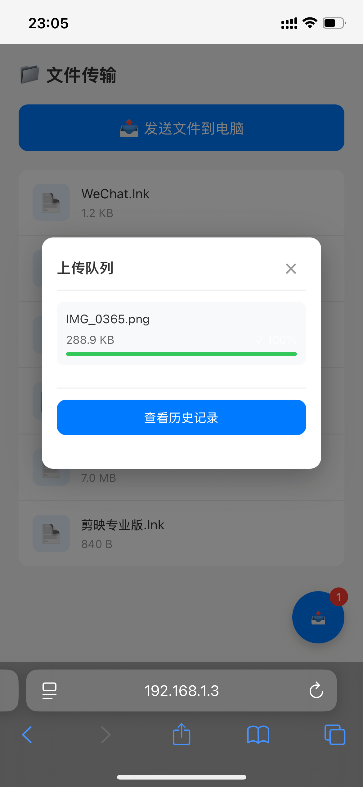

# 迷你互传助手 (Mini Transfer Assistant)

一个轻量级的跨平台桌面应用程序，用于在 PC 和移动设备之间进行文件传输。

## 界面预览

### 桌面应用


### 移动端 - 文件上传


### 移动端 - 文件浏览


## 项目概述

**技术栈：**
- **前端：** Vanilla TypeScript + Vite
- **后端：** Rust + Tauri 2.x
- **HTTP 服务器：** Hyper (Rust)
- **二维码：** qrcode crate

### 核心特性

- 📱 通过二维码快速连接 PC 和移动设备
- 📁 双向文件传输（PC → 手机，手机 → PC）
- 🌐 基于 HTTP 的文件共享服务器
- 🎨 现代化的移动端 Web 界面
- 💻 跨平台支持（Windows/macOS/Linux）
- ⚡ 轻量级设计（目标 < 10MB）
- 🧠 记住上次共享文件夹，启动时自动校验并恢复服务
- 📦 大文件分块上传（1MB/块），带实时进度
- 🛡️ 共享文件夹运行期被删除时自动检测并清理状态
- 🔔 系统托盘常驻：关闭窗口后服务继续在后台运行

## 功能详解

### 1. 桌面应用功能

#### 1.1 文件夹共享
- 用户通过系统对话框选择要共享的文件夹
- 支持选择任意本地文件夹
- 实时显示当前共享的文件夹路径，路径框旁提供三个快捷按钮：**复制路径**、**打开文件夹**（系统文件管理器）、**清空文件夹**
- **记忆功能：** 成功选择后路径保存到本地（`localStorage`）。下次启动时后端校验该路径是否仍存在：
  - 存在 → 自动填入路径并启动服务，开箱即用
  - 不存在 → 清空记录并显示「未选择」，等待重新选择
- 界面提示：要传输的文件放到该文件夹；接收的文件存入子文件夹 `来自手机`

#### 1.2 HTTP 服务器管理
- **自动端口分配：** 在 8000-8999 范围内自动查找可用端口
- **服务器控制：** 支持启动和停止服务器；停止后再启动无需重启应用，直接复用当前文件夹
- **状态显示：** 实时显示服务器运行状态和访问地址，地址可一键复制
- **局域网地址：** 自动获取本机局域网 IP 地址
- **启动提示：** 服务启动/停止、收到文件、文件夹异常等均有 Toast 提示
- **按钮状态：** 未选择文件夹时「启动服务」禁用；运行中显示红色「停止服务」；有文件夹未运行时显示绿色「启动服务」

#### 1.3 二维码生成
- 自动生成包含服务器 URL 的二维码
- QR 码以 PNG（base64 Data URL）格式返回，尺寸 200x200px
- 移动设备扫描即可访问文件共享界面
- 二维码区域与服务区域常显；未启动时显示占位提示

#### 1.4 运行期文件夹保护
- 共享文件夹在服务运行期间若被删除/移动，后端有两条检测路径：
  1. **请求拦截：** 每个 `/api/*` 请求前校验目录，不存在则返回 503 与明确错误，并阻止上传接口重建目录
  2. **定时检测：** 每 10 秒检查一次目录是否仍存在（覆盖「无人访问」的场景）
- 检测到目录消失时通过 `folder-missing` 事件通知前端：自动停止服务、清空路径/二维码/URL，并提示用户重新选择

#### 1.5 系统托盘
- 关闭窗口不会退出应用，而是**隐藏到系统托盘**，HTTP 服务继续在后台运行，手机端仍可传输文件
- 左键单击托盘图标：显示窗口
- 托盘右键菜单：「显示窗口」/「退出」；退出时才真正关闭程序并停止服务、释放端口
- 标题栏与界面显示应用名称「迷你互传助手」及当前版本号

### 2. HTTP API 接口

#### 2.1 GET `/`
**功能：** 返回移动端 Web 界面

**响应：** HTML 页面（mobile/index.html）

---

#### 2.2 GET `/api/files`
**功能：** 列出共享文件夹中的所有文件

**响应格式：**
```json
[
  {
    "name": "example.txt",
    "is_dir": false,
    "size": 1024
  },
  {
    "name": "documents",
    "is_dir": true,
    "size": 0
  }
]
```

**说明：**
- 自动过滤隐藏文件（以 `.` 开头）
- 返回文件名、是否为目录、文件大小（字节）

---

#### 2.3 GET `/api/download?file={filename}`
**功能：** 下载指定文件

**参数：**
- `file` - 文件名（需要 URL 编码）

**响应：**
- Content-Type: `application/octet-stream`
- Content-Disposition: `attachment` 附件下载；采用 RFC 6266 的 `filename` + `filename*=UTF-8''...` 形式，中文等文件名在浏览器中正确显示
- 文件名经过 URL 解码与 `+` 还原，支持中文、`=`、`&`、`+` 等特殊字符；同时拦截 `../` 等路径穿越

**示例：**
```
GET /api/download?file=photo.jpg
GET /api/download?file=%E6%96%87%E6%A1%A3.pdf
```

---

#### 2.4 POST `/api/upload`
**功能：** 上传文件到 PC

**请求：**
- Content-Type: multipart/form-data
- Body: 文件二进制数据

**保存位置：** `{共享文件夹}/来自手机/{文件名}`

**响应格式：**
```json
{
  "success": true,
  "filename": "uploaded_file.jpg"
}
```

**说明：**
- 自动创建 `来自手机` 子文件夹
- 如果文件名已存在，会覆盖原文件
- 适用于小文件；大文件使用下面的分块上传接口

---

#### 2.5 POST `/api/upload/chunk`
**功能：** 分块上传文件（大文件，每块 1MB）

**请求：**
- Content-Type: multipart/form-data（含 `file`、`chunkIndex`、`totalChunks`、`filename` 字段）
- 另有 `X-Chunk-Index` / `X-Total-Chunks` 请求头
- 分块临时存放在 `{共享文件夹}/chunks/{文件名}/chunk_{index}`

**响应格式：**
```json
{
  "success": true,
  "chunk": 0,
  "total": 5
}
```

---

#### 2.6 POST `/api/upload/complete`
**功能：** 合并所有分块，生成最终文件并清理临时分块目录

**请求：**
- Content-Type: application/json
- Body: `{"filename": "big.zip", "totalChunks": 5}`

**响应格式：**
```json
{
  "success": true,
  "filename": "big.zip",
  "size": 5242880
}
```

**说明：** 合并完成后通过 `file-received` 事件通知桌面端弹出提示。

---

#### 2.7 GET `/api/download`、`POST` 等接口的统一错误响应

当共享文件夹在运行期被删除时，所有 `/api/*` 接口（首页 `GET /` 除外）统一返回：

```json
{
  "success": false,
  "error": "共享文件夹已不存在，请在电脑端重新选择"
}
```

HTTP 状态码为 **503 Service Unavailable**，同时桌面端会自动收到通知并清理状态。

---

#### 2.8 OPTIONS `/*`
**功能：** CORS 预检请求支持

**响应头：**
- Access-Control-Allow-Origin: *
- Access-Control-Allow-Methods: GET, POST, OPTIONS
- Access-Control-Allow-Headers: Content-Type

### 3. 移动端界面功能

#### 3.1 文件浏览
- 列表形式展示共享文件夹中的所有文件
- 显示文件图标（根据扩展名显示 emoji）
- 显示文件大小（自动转换为 B/KB/MB）
- 区分文件和文件夹

#### 3.2 文件下载
- 点击文件名即可下载
- 浏览器原生下载处理
- 支持所有常见文件类型

#### 3.3 文件上传
- 点击"发送文件到电脑"按钮
- 选择文件后自动上传
- 小文件直接上传到 `/api/upload`；大文件按 1MB 分块上传到 `/api/upload/chunk`，完成后调用 `/api/upload/complete` 合并
- 显示上传进度（已上传块数 / 总块数，Toast 提示）
- 上传成功后自动刷新文件列表

#### 3.4 UI 特性
- 响应式设计，适配各种移动设备屏幕
- 紫色渐变主题，与桌面应用风格一致
- Toast 提示操作反馈
- 文件图标映射：
  - 📄 未知类型
  - 🖼️ 图片 (jpg, png, gif, webp, svg)
  - 🎬 视频 (mp4, mov, avi, mkv)
  - 🎵 音频 (mp3, wav, flac, m4a)
  - 📦 压缩包 (zip, rar, 7z, tar, gz)
  - 📝 文档 (pdf, doc, docx, txt, md)
  - 📊 表格 (xls, xlsx, csv)
  - 🎨 代码 (js, ts, html, css, py, rs, java, c, cpp)

## 文件传输流程

### 从 PC 到手机（下载）

1. **启动服务**
   - 用户打开桌面应用
   - 若上次使用的共享文件夹仍存在，会**自动恢复路径并启动服务**；否则需点「选择共享文件夹」并选中目录
   - 未选择文件夹时「启动服务」按钮为禁用状态

2. **获取访问地址**
   - 应用自动查找可用端口（8000-8999）
   - 生成服务器 URL（如 `http://192.168.1.100:8080`）
   - 显示二维码

3. **手机访问**
   - 使用手机浏览器或二维码扫描器扫描二维码
   - 打开移动端 Web 界面

4. **下载文件**
   - 浏览文件列表
   - 点击要下载的文件
   - 浏览器处理下载

### 从手机到 PC（上传）

1. **访问服务器**
   - 手机扫描二维码访问服务器

2. **选择文件**
   - 点击"发送文件到电脑"按钮
   - 从手机文件系统选择要上传的文件

3. **上传文件**
   - 文件通过 POST 请求发送到服务器
   - 服务器保存到 `{共享文件夹}/来自手机/` 目录
   - 显示上传成功提示

4. **在 PC 上访问**
   - 打开共享文件夹下的"来自手机"子文件夹
   - 查看上传的文件

## 技术架构

### 前端（TypeScript + Vite）

#### main.ts 核心功能
```typescript
// 1. 文件夹选择（成功后保存路径）
const selected = await open({ directory: true, multiple: false });
if (selected) {
    currentPath = selected;
    saveLastFolder(selected);
    await startServer(selected);
}

// 2. 启动时恢复上次的文件夹（后端校验存在性后自动启动）
await restoreLastFolder();

// 3. 启动服务器 + 生成二维码
const info = await invoke<{ url: string; port: number }>("start_server", { folderPath });
const qrDataUrl = await invoke<string>("generate_qr_code", { url: info.url });

// 4. 启动/停止切换（停止后保留路径，可直接再启动）
await invoke("stop_server");

// 5. 监听后端事件
listen('file-received', ...);    // 收到文件提示
listen('folder-missing', ...);   // 文件夹被删自动清理
```

#### style.css 设计特点
- 紫色渐变背景（`linear-gradient(135deg, #667eea 0%, #764ba2 100%)`）
- 卡片式布局，圆角 12px
- 按钮悬停效果和点击反馈；运行中「停止服务」红色、待启动「启动服务」绿色
- 固定窗口尺寸：560×612px（`tauri.conf.json` 中配置）

### 后端（Rust + Hyper）

#### 核心组件

**1. 应用状态管理**
```rust
struct AppState {
    shared_folder: Arc<Mutex<Option<PathBuf>>>,
    server_handle: Arc<Mutex<Option<JoinHandle<()>>>>,
    app_handle: tauri::AppHandle,  // 向前端发事件
}
```

**2. Tauri 命令**
- `start_server` - 启动 HTTP 服务器（含端口分配、路径校验）
- `stop_server` - 停止服务器
- `validate_folder` - 校验本机路径是否存在且为文件夹（供启动恢复使用）
- `generate_qr_code` - 生成二维码 PNG（base64 Data URL）

**3. HTTP 服务**
- 基于 Hyper 1.x，使用 `service_fn` + `tokio::spawn` 并发处理连接
- Tokio 异步运行时
- 支持 CORS 跨域请求
- 所有 `/api/*` 请求前统一校验共享目录，失效则返回 503
- `run_server` 内用 `tokio::select!` 并行跑一个 10 秒定时检测任务

**4. 路由处理**
路由由 `handle_request` 中的 `match (method, path)` 手动分发（非 axum Router）：

| 方法 | 路径 | 功能 |
|---|---|---|
| GET | `/` | 移动端页面 |
| GET | `/api/files` | 文件列表 |
| GET | `/api/download?file=` | 下载文件 |
| POST | `/api/upload` | 小文件上传 |
| POST | `/api/upload/chunk` | 分块上传 |
| POST | `/api/upload/complete` | 合并分块 |
| OPTIONS | `/*` | CORS 预检 |

**5. 系统托盘**
- `tauri::tray::TrayIconBuilder` 创建托盘图标（`tray-icon` feature）
- 窗口 `CloseRequested` 事件被拦截为隐藏而非退出
- 托盘菜单「退出」执行停服 + `app.exit(0)`

### 移动端（纯 HTML/CSS/JavaScript）

#### 核心功能实现

**文件上传**
```javascript
async function uploadFile(file) {
    const formData = new FormData();
    formData.append('file', file);

    const res = await fetch('/api/upload', {
        method: 'POST',
        body: formData
    });

    const result = await res.json();
    showToast('上传成功！');
    loadFiles(); // 刷新列表
}
```

**文件下载**
```javascript
async function downloadFile(name) {
    const res = await fetch(`/api/download?file=${encodeURIComponent(name)}`);
    if (!res.ok) { showToast('下载失败：文件不存在'); return; }
    const blob = await res.blob();
    const url = URL.createObjectURL(blob);
    const a = document.createElement('a');
    a.href = url;
    a.download = name;  // 用原始文件名，中文名可正确保存
    a.click();
    URL.revokeObjectURL(url);
}
```

**文件列表加载**
```javascript
async function loadFiles() {
    const res = await fetch('/api/files');
    const files = await res.json();
    if (!Array.isArray(files)) {       // 兼容后端错误响应（如 503）
        showToast(files.error || '加载失败');
        return;
    }
    renderFileList(files);
}
```

## 项目结构

```
mini-transfer/
├── src/                    # 前端 TypeScript 代码
│   ├── main.ts            # 桌面应用主逻辑
│   └── style.css          # 桌面应用样式
├── src-tauri/             # Rust 后端代码
│   ├── src/
│   │   ├── main.rs        # HTTP 服务器、Tauri 命令、托盘
│   │   └── lib.rs         # Tauri 占位文件
│   ├── mobile/            # 移动端 Web 界面
│   │   └── index.html     # 移动端文件管理界面
│   ├── capabilities/      # Tauri 权限配置
│   │   └── default.json
│   ├── icons/             # 应用图标
│   ├── Cargo.toml         # Rust 依赖配置
│   ├── tauri.conf.json    # Tauri 应用配置
│   ├── rust-toolchain.toml # 锁定 Rust 工具链版本
│   └── build.rs            # 构建脚本
├── index.html              # 桌面应用入口
├── package.json            # Node.js 项目配置
├── vite.config.ts          # Vite 构建配置
└── readme.md               # 项目文档
```

> 全局 Cargo 镜像配置位于 `C:\Users\<用户名>\.cargo\config.toml`（见下文「开发环境提示」），不属于本仓库。

## 安装与运行

### 前置要求

1. **Node.js** - 用于前端构建
2. **Rust** - Tauri 后端必需
   - Windows: 下载 [rustup-init.exe](https://rustup.rs/) 或运行 `winget install Rustlang.Rustup`
   - 安装后重启终端并验证：`cargo --version`
3. **系统 WebView** - Tauri 使用系统 WebView（无需打包 Chromium）

### 开发

```bash
# 安装依赖
npm install

# 启动开发服务器（仅前端）
npm run dev

# 启动完整 Tauri 开发环境
npm run tauri dev
```

### 构建

```bash
# 构建前端
npm run build

# 构建完整应用
npm run tauri build
```

### 开发环境提示

- **Rust 工具链：** 项目通过 `src-tauri/rust-toolchain.toml` 锁定版本，首次打开工程时 rustup 会自动安装对应工具链，无需手动切换。
- **国内下载加速：** 若 `cargo` 拉取依赖缓慢/超时，可在 `C:\Users\<用户名>\.cargo\config.toml` 配置镜像（如字节 rsproxy 的 sparse 索引）：
  ```toml
  [source.crates-io]
  replace-with = "rsproxy"
  [source.rsproxy]
  registry = "sparse+https://rsproxy.cn/index/"
  ```
- **前端产物：** `generate_context!()` 要求 `dist/` 存在，首次编译前先执行一次 `npm run build`。

### Windows 构建输出

- `src-tauri/target/release/` - 原始可执行文件
- `src-tauri/target/release/bundle/` - 安装包（当前配置仅 NSIS：`.exe` 安装器）

## 性能优化

### 减小构建体积

在 `Cargo.toml` 中启用以下配置：

```toml
[profile.release]
lto = true           # 链接时优化
codegen-units = 1    # 单一代码单元
opt-level = "z"      # 优化体积
strip = true         # 移除调试符号
```

### 使用 cargo strip（Windows）

```bash
cd src-tauri
cargo build --release
strip target/release/mini-transfer.exe
```

## 安全特性

- ✅ **CORS 支持** - 允许跨域访问，方便移动设备访问
- ✅ **路径安全** - 下载接口拦截 `../` 等路径穿越，只允许共享目录内的相对文件名
- ✅ **文件过滤** - 自动跳过隐藏文件（以 `.` 开头）
- ✅ **运行期目录校验** - 共享文件夹被删除时拦截所有 API 请求，阻止上传接口重建目录
- ✅ **中文文件名支持** - 正确的 URL 解码与 RFC 6266 `filename*` 响应头
- ⚠️ **局域网使用** - 服务监听 `0.0.0.0`，建议仅在受信任的局域网环境中使用

## 技术亮点

### 跨平台兼容性
- **Tauri 2.x** - 支持 Windows、macOS、Linux
- **系统 WebView** - 使用系统原生 WebView，无需打包 Chromium
- **自动端口分配** - 避免端口冲突

### 用户体验
- **二维码快速连接** - 无需手动输入 URL
- **现代化 UI** - 紫色渐变主题，卡片式设计
- **实时反馈** - 操作状态实时显示
- **文件图标** - 直观的文件类型识别

### 开发体验
- **类型安全** - TypeScript 前端 + Rust 后端
- **热重载** - Vite 开发服务器支持
- **简洁架构** - 前后端职责清晰分离

## 常见问题

### Q: 为什么选择 Tauri 而不是 Electron？
A: Tauri 使用系统 WebView，体积更小（目标 < 10MB），而 Electron 需要打包整个 Chromium，通常 > 100MB。

### Q: 支持哪些移动设备？
A: 任何具有现代浏览器的移动设备（iOS Safari、Android Chrome 等）。

### Q: 可以传输多大的文件？
A: 理论上无限制，实际受可用磁盘空间和浏览器限制影响。

### Q: 是否需要互联网连接？
A: 不需要。所有通信都在局域网内进行，PC 和手机需要连接到同一个 Wi-Fi 网络。

### Q: 点击窗口的关闭按钮后应用退出了吗？
A: 没有。关闭窗口只是隐藏到系统托盘，服务仍在后台运行，手机可继续传输。要彻底退出，请右键托盘图标选择「退出」。

### Q: 每次启动都要重新选文件夹吗？
A: 不用。上次成功使用的文件夹会被记住，若路径仍存在则自动恢复并启动服务；被删除时会自动清空并提示重选。

### Q: 如何更改端口范围？
A: 在 `src-tauri/src/main.rs` 中修改 `find_available_port()` 函数的端口范围参数（当前为 `8000..9000`）。

## 许可证

本项目采用 MIT 许可证。

## 贡献

欢迎提交 Issue 和 Pull Request！

---

**最后更新：** 2026-11-25
