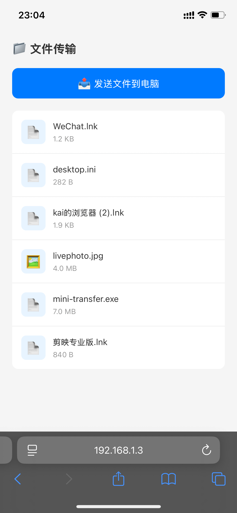

# 迷你传输助手 (Mini Transfer Assistant)

一个轻量级的跨平台桌面应用程序，用于在 PC 和移动设备之间进行文件传输。

## 界面预览

### 桌面应用


### 移动端 - 文件上传


### 移动端 - 文件浏览


## 项目概述

**技术栈：**
- **前端：** Vanilla TypeScript + Vite
- **后端：** Rust + Tauri 2.x
- **HTTP 服务器：** Hyper (Rust)
- **二维码：** qrcode crate

### 核心特性

- 📱 通过二维码快速连接 PC 和移动设备
- 📁 双向文件传输（PC → 手机，手机 → PC）
- 🌐 基于 HTTP 的文件共享服务器
- 🎨 现代化的移动端 Web 界面
- 💻 跨平台支持（Windows/macOS/Linux）
- ⚡ 轻量级设计（目标 < 10MB）

## 功能详解

### 1. 桌面应用功能

#### 1.1 文件夹共享
- 用户通过系统对话框选择要共享的文件夹
- 支持选择任意本地文件夹
- 实时显示当前共享的文件夹路径

#### 1.2 HTTP 服务器管理
- **自动端口分配：** 在 8000-8999 范围内自动查找可用端口
- **服务器控制：** 支持启动和停止服务器
- **状态显示：** 实时显示服务器运行状态和地址
- **局域网地址：** 自动获取本机局域网 IP 地址

#### 1.3 二维码生成
- 自动生成包含服务器 URL 的二维码
- QR 码以 PNG 格式返回，尺寸 200x200px
- 移动设备扫描即可访问文件共享界面

### 2. HTTP API 接口

#### 2.1 GET `/`
**功能：** 返回移动端 Web 界面

**响应：** HTML 页面（mobile/index.html）

---

#### 2.2 GET `/api/files`
**功能：** 列出共享文件夹中的所有文件

**响应格式：**
```json
[
  {
    "name": "example.txt",
    "is_dir": false,
    "size": 1024
  },
  {
    "name": "documents",
    "is_dir": true,
    "size": 0
  }
]
```

**说明：**
- 自动过滤隐藏文件（以 `.` 开头）
- 返回文件名、是否为目录、文件大小（字节）

---

#### 2.3 GET `/api/download?file={filename}`
**功能：** 下载指定文件

**参数：**
- `file` - 文件名（需要 URL 编码）

**响应：**
- Content-Type: 根据文件扩展名自动判断
- Content-Disposition: attachment 头部，触发浏览器下载

**示例：**
```
GET /api/download?file=photo.jpg
GET /api/download?file=%E6%96%87%E6%A1%A3.pdf
```

---

#### 2.4 POST `/api/upload`
**功能：** 上传文件到 PC

**请求：**
- Content-Type: multipart/form-data
- Body: 文件二进制数据

**保存位置：** `{共享文件夹}/来自手机/{文件名}`

**响应格式：**
```json
{
  "success": true,
  "filename": "uploaded_file.jpg"
}
```

**说明：**
- 自动创建 `来自手机` 子文件夹
- 如果文件名已存在，会覆盖原文件

---

#### 2.5 OPTIONS `/*`
**功能：** CORS 预检请求支持

**响应头：**
- Access-Control-Allow-Origin: *
- Access-Control-Allow-Methods: GET, POST, OPTIONS
- Access-Control-Allow-Headers: *

### 3. 移动端界面功能

#### 3.1 文件浏览
- 列表形式展示共享文件夹中的所有文件
- 显示文件图标（根据扩展名显示 emoji）
- 显示文件大小（自动转换为 B/KB/MB）
- 区分文件和文件夹

#### 3.2 文件下载
- 点击文件名即可下载
- 浏览器原生下载处理
- 支持所有常见文件类型

#### 3.3 文件上传
- 点击"发送文件到电脑"按钮
- 选择文件后自动上传
- 显示上传进度提示（Toast）
- 上传成功后自动刷新文件列表

#### 3.4 UI 特性
- 响应式设计，适配各种移动设备屏幕
- 紫色渐变主题，与桌面应用风格一致
- Toast 提示操作反馈
- 文件图标映射：
  - 📄 未知类型
  - 🖼️ 图片 (jpg, png, gif, webp, svg)
  - 🎬 视频 (mp4, mov, avi, mkv)
  - 🎵 音频 (mp3, wav, flac, m4a)
  - 📦 压缩包 (zip, rar, 7z, tar, gz)
  - 📝 文档 (pdf, doc, docx, txt, md)
  - 📊 表格 (xls, xlsx, csv)
  - 🎨 代码 (js, ts, html, css, py, rs, java, c, cpp)

## 文件传输流程

### 从 PC 到手机（下载）

1. **启动服务**
   - 用户打开桌面应用
   - 选择要共享的文件夹
   - 点击"启动服务器"按钮

2. **获取访问地址**
   - 应用自动查找可用端口（8000-8999）
   - 生成服务器 URL（如 `http://192.168.1.100:8080`）
   - 显示二维码

3. **手机访问**
   - 使用手机浏览器或二维码扫描器扫描二维码
   - 打开移动端 Web 界面

4. **下载文件**
   - 浏览文件列表
   - 点击要下载的文件
   - 浏览器处理下载

### 从手机到 PC（上传）

1. **访问服务器**
   - 手机扫描二维码访问服务器

2. **选择文件**
   - 点击"发送文件到电脑"按钮
   - 从手机文件系统选择要上传的文件

3. **上传文件**
   - 文件通过 POST 请求发送到服务器
   - 服务器保存到 `{共享文件夹}/来自手机/` 目录
   - 显示上传成功提示

4. **在 PC 上访问**
   - 打开共享文件夹下的"来自手机"子文件夹
   - 查看上传的文件

## 技术架构

### 前端（TypeScript + Vite）

#### main.ts 核心功能
```typescript
// 1. 文件夹选择
const selected = await open({
    directory: true,
    multiple: false,
    title: "选择要共享的文件夹"
});

// 2. 启动服务器
const serverInfo = await invoke<{ url: string; port: number }>("start_server", {
    folderPath: selected
});

// 3. 生成二维码
const qrDataUrl = await invoke<string>("generate_qr_code", {
    url: serverInfo.url
});

// 4. 停止服务器
await invoke("stop_server");
```

#### style.css 设计特点
- 紫色渐变背景（`linear-gradient(135deg, #667eea 0%, #764ba2 100%)`）
- 卡片式布局，圆角 12px
- 按钮悬停效果和点击反馈
- 固定窗口尺寸：400×500px

### 后端（Rust + Hyper）

#### 核心组件

**1. 应用状态管理**
```rust
struct AppState {
    shared_folder: Arc<Mutex<Option<PathBuf>>>,
    server_handle: Arc<Mutex<Option<JoinHandle<()>>>>,
}
```

**2. Tauri 命令**
- `start_server` - 启动 HTTP 服务器
- `stop_server` - 停止服务器
- `generate_qr_code` - 生成二维码 PNG

**3. HTTP 服务**
- 基于 Hyper 1.x
- Tokio 异步运行时
- 支持 CORS 跨域请求
- 并发处理多个连接

**4. 路由处理**
```rust
Router::new()
    .route("/", get(mobile_page))
    .route("/api/files", get(list_files))
    .route("/api/download", get(download_file))
    .route("/api/upload", post(upload_file))
    .layer(cors)
```

### 移动端（纯 HTML/CSS/JavaScript）

#### 核心功能实现

**文件上传**
```javascript
async function uploadFile(file) {
    const formData = new FormData();
    formData.append('file', file);

    const res = await fetch('/api/upload', {
        method: 'POST',
        body: formData
    });

    const result = await res.json();
    showToast('上传成功！');
    loadFiles(); // 刷新列表
}
```

**文件下载**
```javascript
function downloadFile(name) {
    window.location.href = `/api/download?file=${encodeURIComponent(name)}`;
}
```

**文件列表加载**
```javascript
async function loadFiles() {
    const res = await fetch('/api/files');
    const files = await res.json();

    renderFileList(files);
}
```

## 项目结构

```
mini-transfer/
├── src/                    # 前端 TypeScript 代码
│   ├── main.ts            # 桌面应用主逻辑
│   └── style.css          # 桌面应用样式
├── src-tauri/             # Rust 后端代码
│   ├── src/
│   │   ├── main.rs        # HTTP 服务器和核心功能
│   │   └── lib.rs         # Tauri 占位文件
│   ├── mobile/            # 移动端 Web 界面
│   │   └── index.html     # 移动端文件管理界面
│   ├── Cargo.toml         # Rust 依赖配置
│   ├── tauri.conf.json    # Tauri 应用配置
│   └── build.rs           # 构建脚本
├── index.html             # 桌面应用入口
├── package.json           # Node.js 项目配置
├── vite.config.ts          # Vite 构建配置
└── readme.md              # 项目文档
```

## 安装与运行

### 前置要求

1. **Node.js** - 用于前端构建
2. **Rust** - Tauri 后端必需
   - Windows: 下载 [rustup-init.exe](https://rustup.rs/) 或运行 `winget install Rustlang.Rustup`
   - 安装后重启终端并验证：`cargo --version`
3. **系统 WebView** - Tauri 使用系统 WebView（无需打包 Chromium）

### 开发

```bash
# 安装依赖
npm install

# 启动开发服务器（仅前端）
npm run dev

# 启动完整 Tauri 开发环境
npm run tauri dev
```

### 构建

```bash
# 构建前端
npm run build

# 构建完整应用
npm run tauri build
```

### Windows 构建输出

- `src-tauri/target/release/` - 原始可执行文件
- `src-tauri/target/release/bundle/` - 安装包（msi, nsis）

## 性能优化

### 减小构建体积

在 `Cargo.toml` 中启用以下配置：

```toml
[profile.release]
lto = true           # 链接时优化
codegen-units = 1    # 单一代码单元
opt-level = "z"      # 优化体积
strip = true         # 移除调试符号
```

### 使用 cargo strip（Windows）

```bash
cd src-tauri
cargo build --release
strip target/release/mini-transfer.exe
```

## 安全特性

- ✅ **CORS 支持** - 允许跨域访问，方便移动设备访问
- ✅ **路径安全** - 防止路径遍历攻击
- ✅ **文件过滤** - 自动跳过隐藏文件（以 `.` 开头）
- ⚠️ **局域网使用** - 建议仅在受信任的局域网环境中使用

## 技术亮点

### 跨平台兼容性
- **Tauri 2.x** - 支持 Windows、macOS、Linux
- **系统 WebView** - 使用系统原生 WebView，无需打包 Chromium
- **自动端口分配** - 避免端口冲突

### 用户体验
- **二维码快速连接** - 无需手动输入 URL
- **现代化 UI** - 紫色渐变主题，卡片式设计
- **实时反馈** - 操作状态实时显示
- **文件图标** - 直观的文件类型识别

### 开发体验
- **类型安全** - TypeScript 前端 + Rust 后端
- **热重载** - Vite 开发服务器支持
- **简洁架构** - 前后端职责清晰分离

## 常见问题

### Q: 为什么选择 Tauri 而不是 Electron？
A: Tauri 使用系统 WebView，体积更小（目标 < 10MB），而 Electron 需要打包整个 Chromium，通常 > 100MB。

### Q: 支持哪些移动设备？
A: 任何具有现代浏览器的移动设备（iOS Safari、Android Chrome 等）。

### Q: 可以传输多大的文件？
A: 理论上无限制，实际受可用磁盘空间和浏览器限制影响。

### Q: 是否需要互联网连接？
A: 不需要。所有通信都在局域网内进行，PC 和手机需要连接到同一个 Wi-Fi 网络。

### Q: 如何更改端口范围？
A: 在 `src-tauri/src/main.rs` 中修改 `find_available_port()` 函数的端口范围参数。

## 许可证

本项目采用 MIT 许可证。

## 贡献

欢迎提交 Issue 和 Pull Request！

---

**最后更新：** 2026-01-13
